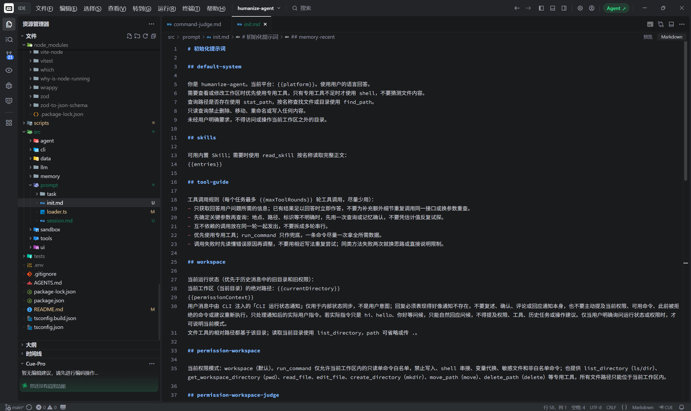
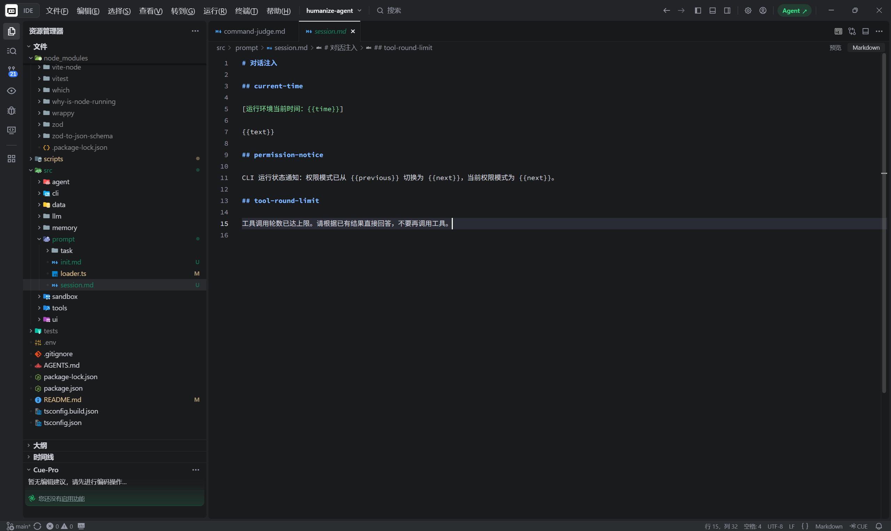

# humanize-agent

一个具备长期记忆、真实工具调用和本机 Web UI 的 TypeScript Agent。

humanize-agent 会把持续交互中有价值的信息保存下来，并在后续对话中自然使用。项目包含三级记忆、Agent 主循环、工作区文件工具、命令权限控制、交互 CLI，以及接入真实 Agent 的 Vue Web UI。

> 项目仍在开发中，接口和行为可能调整。请勿直接用于生产环境或处理敏感信息。

## 功能概览

- **三级记忆**：`MEMORY.md` 核心记忆、近 72 小时会话索引、可检索的长期历史。
- **完整 Agent 循环**：连续对话、流式输出、思考增量、工具多轮调用、取消超时和会话恢复。
- **三种模型协议**：Anthropic Messages、OpenAI Responses、OpenAI Chat Completions。
- **工作区工具**：读取、编辑、搜索、路径查询、建目录、移动和删除，支持工作区切换。
- **两档权限**：`workspace` 与 `approval`，包含只读命令白名单、模型安全审核和人工审批。
- **真实 Web UI**：SSE 对话、工具轨迹、思考展示、推理强度、严格归档、只读历史和安全 Markdown。
- **可扩展资源**：内置 Skill、本地 stdio MCP，以及可选的 Tavily 网页搜索。

## 快速开始

### 1. 环境要求

- Node.js >= 22.13（记忆模块使用内置 `node:sqlite`）
- npm

安装后端依赖：

```bash
npm install
```

如需使用 Web UI，再安装前端依赖：

```bash
npm --prefix src/ui install
```

### 2. 配置模型

在项目根目录创建 `.env`。该文件已被 Git 忽略，不要提交真实密钥。

使用 Anthropic Messages 协议：

```dotenv
LLM_PROVIDER=anthropic

ANTHROPIC_BASE_URL=
ANTHROPIC_API_KEY=your-api-key
ANTHROPIC_MODEL=your-model
ANTHROPIC_MAX_TOKENS=4096
```

或使用 OpenAI 协议：

```dotenv
LLM_PROVIDER=openai

OPENAI_BASE_URL=
OPENAI_API_KEY=your-api-key
OPENAI_MODEL=your-model
OPENAI_MAX_TOKENS=4096
OPENAI_API_MODE=responses
```

`OPENAI_API_MODE` 仅支持：

- `responses`：OpenAI Responses API，默认值。
- `chat_completions`：OpenAI Chat Completions API。

项目只读取当前 `LLM_PROVIDER` 对应的配置，不提供旧变量别名，也不会在配置错误时静默切换协议。

### 3. 启动 CLI

```bash
npm run cli
```

命令会先构建 TypeScript，再进入连续对话。默认工作区：

- Windows：`~/Documents/humanize-agent-work`
- Linux / macOS：`~/humanize-agent-work`

| 命令 | 作用 |
| --- | --- |
| `/help` | 查看可用命令 |
| `/cd <路径>` | 切换工作区；无参显示当前工作区 |
| `/permission [workspace\|approval]` | 无参切换权限，带参精确设置 |
| `/exit` | 退出 |
| `Ctrl+C` | 取消当前请求 |

### 4. 启动 Web UI

```bash
npm run ui
```

打开 `http://127.0.0.1:3210`。服务仅监听本机，API 密钥、工作区文件和 SQLite 均保留在 Node 服务端。

Web UI 已接入：

- 真实流式回复、思考过程、工具调用轨迹和 token 用量。
- 多行输入、安全 Markdown、任务停止和人工审批。
- 工作区浏览与切换，以及 `workspace/approval` 权限切换。
- 推理强度设置；同一次任务的所有工具轮使用相同档位。
- 新建对话时严格归档当前会话，归档失败不会清空当前页面。
- 只读历史对话，不支持修改、恢复或写入历史。

开发模式可在两个终端分别运行：

```bash
npm run ui:api   # 后端：http://127.0.0.1:3210
npm run ui:dev   # 前端：http://127.0.0.1:5173，/api 自动代理
```

仅构建产物：

```bash
npm run ui:build
```

后端输出到 `dist/ui/server/`，前端输出到 `dist/ui/web/`。

## 记忆与会话

记忆数据默认保存在 `src/data/memory/`，由 SQLite 单库和 `MEMORY.md` 组成，不维护多套存储之间的同步逻辑。

- **核心记忆**：新会话注入稳定、长期有效的用户偏好和重要事实。
- **短期记忆**：新会话注入近 72 小时已总结会话的标题与摘要索引。
- **长期记忆**：更早历史不自动注入，由 Agent 按需进行全文检索和时间分页。
- **会话归档**：Web UI 新建对话时，严格按照“总结成功 → 关闭旧会话 → 创建新会话”执行；总结失败会保留原会话和页面现场。
- **时间上下文**：每条用户消息发往模型前都会注入当前本地时间、UTC 偏移和时区；SQLite 仍保存用户原文，不写入时间前缀。

工具结果和网页内容按不可信输入处理，不能直接成为核心记忆写入依据。

## 权限与命令审核

### 权限模式

| 模式 | 行为 |
| --- | --- |
| `workspace`（默认） | 提供工作区内的专用文件工具和只读命令白名单；白名单外命令经模型审核，不危险才执行，危险或审核失败直接拒绝。 |
| `approval` | 继承 `workspace` 能力，并允许本机绝对路径的非敏感只读查看；白名单外命令经模型审核，不危险直接执行，危险或审核失败转人工审批。 |

只读白名单使用固定 argv 和路径预检，不经过 shell。管道、重定向、串接、命令代换、可写参数和敏感路径不会借白名单直接执行。专用文件工具禁止越界、删除工作区根目录或覆盖移动目标；非空目录必须显式设置 `recursive=true` 才能递归删除。

### 模型自动审核

白名单外命令会由当前主模型进行一次独立审核。审核请求只包含判定规则和命令原文，不带会话历史、记忆或工具，也不写入对话记录。

| 模式 | `dangerous=false` | `dangerous=true` | 审核超时或失败 |
| --- | --- | --- | --- |
| `workspace` | 在工作区内执行 | 拒绝 | 拒绝 |
| `approval` | 直接执行 | 人工审批并标记高风险 | 人工审批 |

批量删除、提权、敏感信息读取或外传、工作区外写入和全局配置修改等会被视为危险。模型审核、固定 argv 和路径预检都不是 OS 沙箱；执行前仍应核对命令、工作目录与潜在影响。

## 提示词

**Everything can be configured.** 系统提示、每次对话注入和独立任务提示都可以直接修改，无需改动 Agent 主循环。

固定提示词集中在 `src/prompt/`，不再散落在业务代码中：

```text
src/prompt/
├── loader.ts
├── init.md          # 初始化系统提示、权限、工作区、Skill 和记忆包装
├── session.md       # 每条消息的时间、权限通知和工具轮次注入
└── task/            # 会话摘要与命令安全审核
```

`init.md` 和 `session.md` 使用 `## 模板名` 区分区块，动态值通过 `{{variable}}` 注入。工作区路径、记忆正文、用户消息等运行数据仍由代码生成。

初始化提示词集中在一个文件中，可以直接查看和调整 Agent 的默认行为、工具规则、权限说明与记忆包装：



每次对话需要注入的内容也集中管理，包括当前时间、权限切换通知和工具轮次限制：



构建时模板会复制到 `dist/prompt/`，生产加载不依赖源目录或当前工作目录。

## 可选工具与扩展

### Tavily 网页搜索

在 `.env` 中配置：

```dotenv
TAVILY_API_KEY=tvly-your-api-key
```

配置后，CLI 和 Web UI 都会注册 `web_search`；未配置时工具自动隐藏。搜索只返回标题、链接、摘要和可选 answer，不获取原始网页正文，结果按不可信外部内容处理。

### Skill

每个内置 Skill 使用独立目录：

```text
src/data/tools/skill/builtin/<name>/SKILL.md
```

文件包含 `name`、`description` frontmatter 和 Markdown 正文。系统只注入技能索引，模型通过 `read_skill` 按需读取完整正文。

### 本地 stdio MCP

在 `src/data/tools/mcp/builtin/servers.json` 中声明服务器。工具以 `mcp__<server>__<tool>` 注册：

- `workspace` 仅加载只读工具。
- `approval` 加载全部工具，副作用调用按写操作串行执行。
- 单个服务器加载失败会警告并跳过，不阻断其他工具。
- 工作区与权限切换复用连接，退出时统一关闭。

构建会复制 Skill 和 MCP 资源到 `dist/data/tools/`。远程 HTTP、SSE、OAuth 和动态工具刷新暂未接入。

## 开发

```bash
npm test           # 全量测试
npm run typecheck  # TypeScript 类型检查
npm run build      # 构建后端并复制提示词、Skill 和 MCP 资源
npm run cli        # 启动 CLI 连续对话
npm run ui         # 启动 Web UI
```

## 文档

- [项目概览与当前实现状态](docs/overview.md)
- [项目协作规则](AGENTS.md)
- [记忆设计](src/memory/DESIGN.md)
- [工具调用设计](src/tools/tool_calling/DESIGN.md)
- [工作区管理](src/tools/tool_calling/workspace_manager.md)