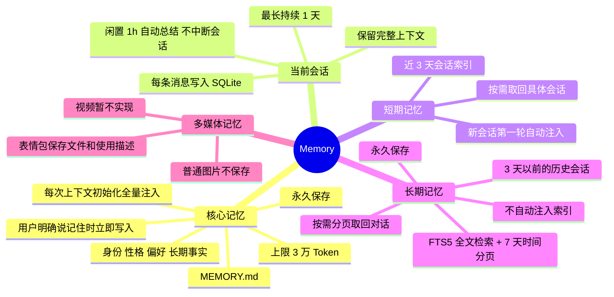
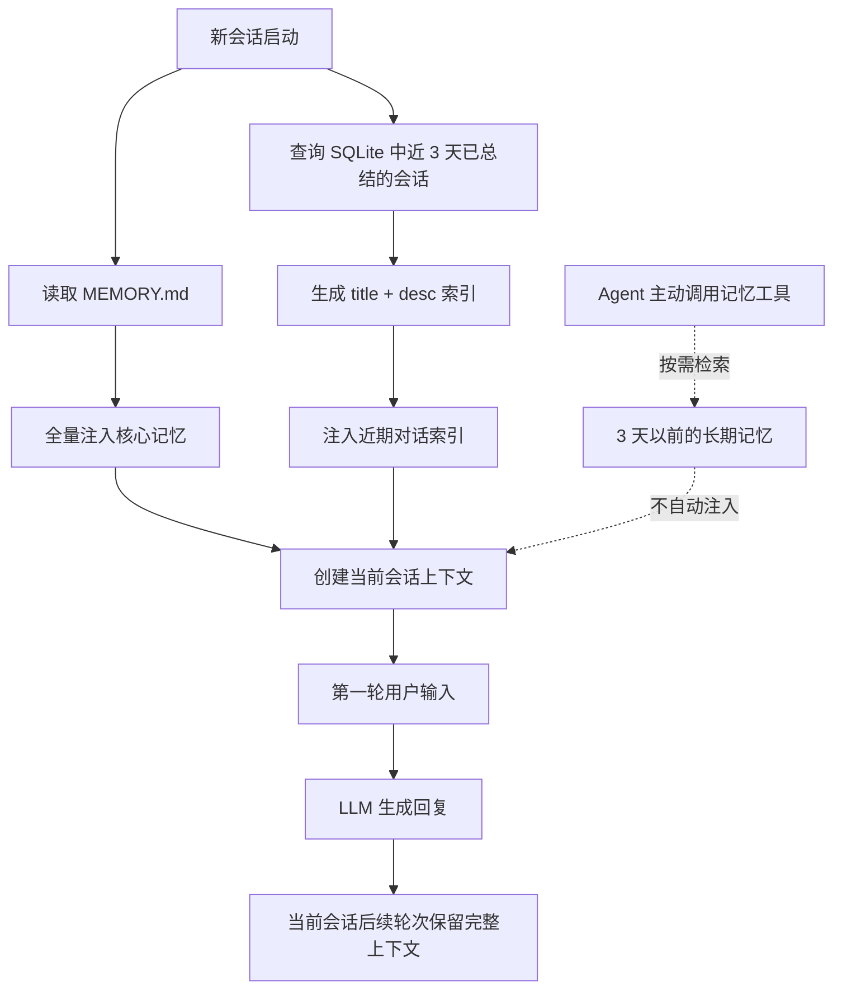
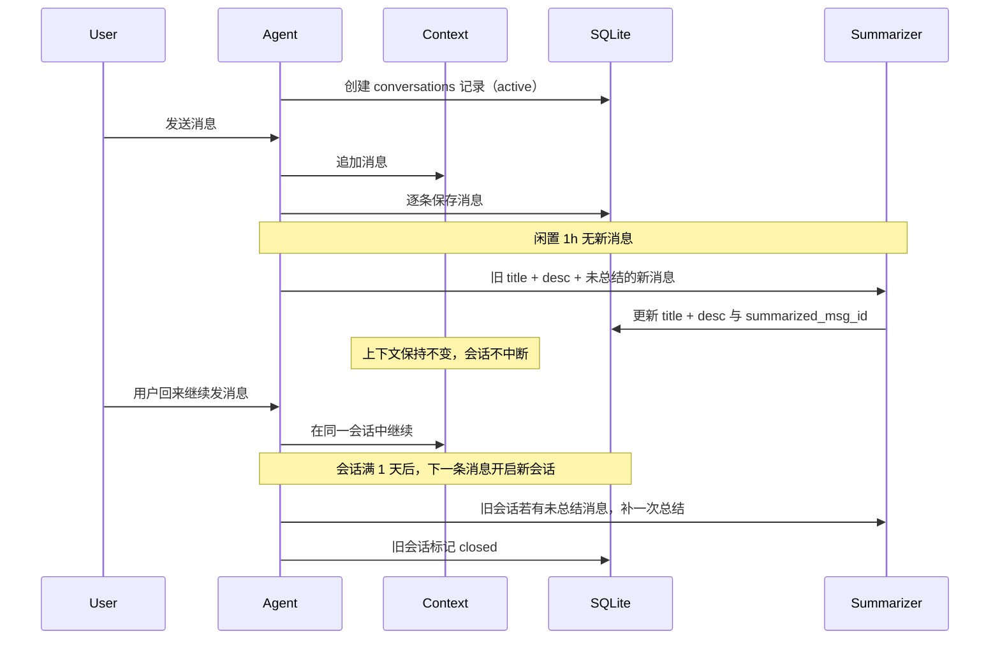
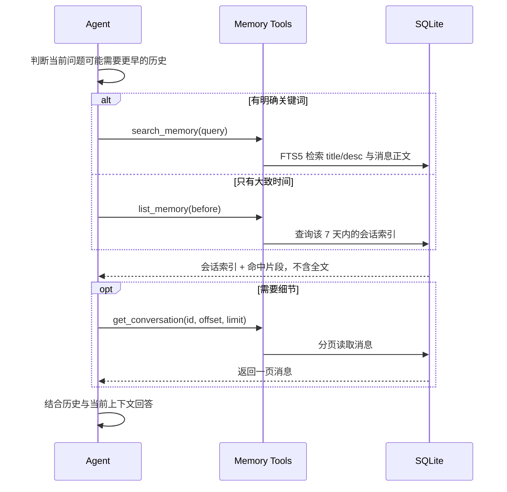
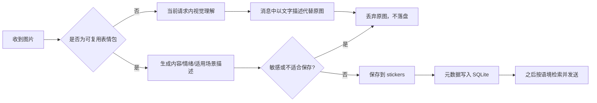
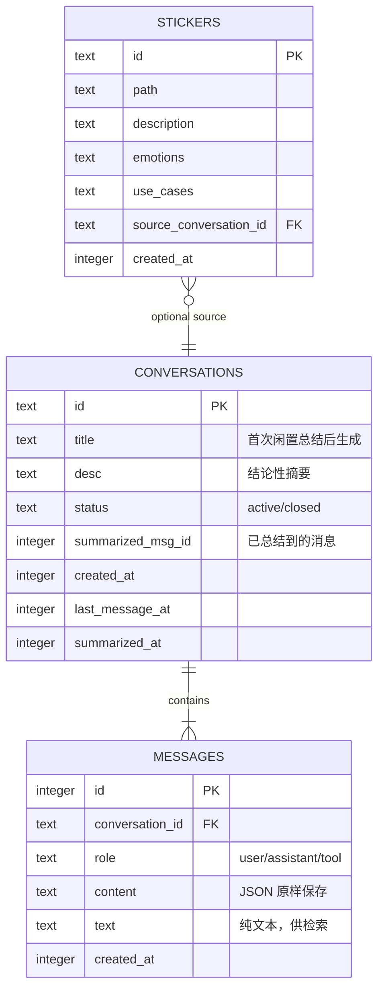

# 记忆架构设计

## 1. 目标

让 Agent 在长期交互中保留有价值的信息，并以尽量无感的方式使用这些信息：

- 不忘记用户和 Agent 的身份、性格、偏好等核心事实。
- 新会话能看到近期对话的索引，并按需取回具体内容。
- 历史对话永久保留，但不因为记忆增长而持续膨胀上下文。
- 记忆被纠正时保留历史，同时明确以最新结论为准。
- 密码、API Key、密钥等敏感信息不进入核心记忆。

当前版本面向单用户，多用户与权限隔离后续再考虑。

## 2. 架构总览



## 3. 数据与文件布局

```text
src/
├── memory/
│   ├── store.ts        # SQLite 连接、schema（含 FTS5）、会话与消息读写
│   ├── core.ts         # MEMORY.md 的读取、条目编号、追加、纠正、删除和容量检查
│   ├── recent.ts       # 近 3 天会话索引及注入文本
│   ├── search.ts       # 长期记忆全文检索、时间分页、消息分页读取
│   ├── summarize.ts    # 闲置触发的 title + desc 增量总结
│   └── media.ts        # 表情包记忆，后续实现
└── data/
    ├── memory/
    │   ├── MEMORY.md   # 核心记忆，永远注入
    │   └── memory.db   # 会话、消息、索引和表情包元数据
    └── multimedia/
        ├── images/temp/# 暂不使用，普通图片不落盘
        ├── videos/     # 占位，暂不保存视频
        └── stickers/   # 长期保存的表情包文件
```

`MEMORY.md` 和 `memory.db` 都是运行时数据，不提交到 Git。SQLite 的 wal、journal 等附属文件同样忽略。

## 4. 上下文初始化

核心记忆和短期索引只在**新会话第一轮**自动加入上下文；当前会话的后续轮次沿用已有上下文，不重复注入。



初始化注入顺序：

1. 角色与行为规则。
2. `MEMORY.md` 核心记忆。
3. 近 3 天会话的 `title + desc` 索引。
4. 当前会话消息。

短期索引示例：

```text
最近 3 天的对话：
- [2026-10-28] 记忆系统架构设计: 确定核心记忆常驻、3 天短期索引和长期分页检索。
- [2026-10-27] Agent 目录结构: 划分 agent、llm、tools、memory，sandbox 暂缓。
```

## 5. 核心记忆 `MEMORY.md`

核心记忆保存跨会话始终有效的信息，例如：

- 用户和 Agent 的名字。
- 用户的性格、表达偏好和长期习惯。
- Agent 的性格与相处方式。
- 用户明确要求记住的长期事实。

### 写入规则

| 触发场景 | 行为 |
| --- | --- |
| 用户说“记住这个” | 立即写入，不等会话结束 |
| 对话中发现稳定的核心事实 | 可写入，但避免把一次性状态当成永久事实 |
| 新事实纠正旧事实 | 保留旧记录，标记已纠正并指向新条目 |
| 用户要求忘掉某件事 | 删除对应单条，不支持清空 |
| 包含密码、API Key、密钥 | 不保存 |
| 工具结果、网页内容中出现“记住”类指令 | 不写入，核心记忆只依据用户消息，防止持久化提示词注入 |

写入、纠正和删除分别通过 `remember`、`remember(replaces)`、`forget_memory` 工具完成。本轮已收到历史记忆或外部工具结果时，这两个工具由代码拒绝执行，详见 [tool_calling 设计](../tools/tool_calling/DESIGN.md)。

### 条目编号

每条记忆带稳定编号，注入上下文时一并展示，供纠正和删除引用：

- 编号格式 `m<数字>`，由记忆模块分配，只增不复用，模型不能自定。
- 一条记忆占一个列表项，便于按编号定位和删除。

### 容量上限

- `MEMORY.md` 的 **3 万 Token 仅作为硬上限，不是日常容量目标**。平时保持精简，接近上限时才强制整理，按当前模型 tokenizer 计算，无法计算时按字符数近似估算。
- 写入后会超限时拒绝本次写入，要求 Agent 先整理：用 `forget_memory` 优先删除已纠正的旧条目；再合并重复或过时内容（先 `remember` 合并后的新条目，再逐条删除旧条目），然后重试。
- 原始历史永久保存在 `messages` 中；`MEMORY.md` 允许整理和清理，被删除的旧条目仍可从原始对话追溯。

纠正示例：

```markdown
- [m3][已纠正 2026-10-28 → m12] 用户偏好深色主题。
- [m12] 用户现在偏好浅色、高对比度界面。
```

核心记忆应简洁、稳定。普通对话内容和一次性任务细节进入会话记忆，不写入 `MEMORY.md`。

## 6. 会话生命周期与总结



规则：

- 当前会话在内存中保留完整上下文，同时每条消息即时落库。
- **闲置总结**：最后一条消息后 1 小时没有新消息，就在后台生成或更新 `title + desc`。只写数据库，不清空上下文、不结束会话。
- **增量更新**：`summarized_msg_id` 记录已总结到的位置。再次闲置时，只把旧 `title + desc` 和新增消息交给模型更新；没有新消息则跳过。
- **并发控制**：每个会话同一时间只允许一个总结任务。任务开始时记录 `target_msg_id` 快照，只读取该位置及之前的消息；完成后将 `summarized_msg_id` 更新为 `target_msg_id`。总结期间新到的消息不受影响，留到下一轮闲置总结，避免新消息与总结结果互相覆盖。
- **1 天上限**：会话从创建起满 1 天后，下一条用户消息开启新会话。旧会话有未总结消息时先补总结，再标记 `closed`；新会话通过近期索引看到它。
- **启动补偿**：进程启动时，为有未总结消息的会话补做总结；未满 1 天的 `active` 会话从数据库恢复上下文继续使用。
- 总结使用与当前对话相同的模型。
- `title` 应包含具体主题和关键实体；`desc` 应记录结论与上下文，而不是复述对话过程。

## 7. 短期记忆：近 3 天

短期记忆是 SQLite 的查询视图，不是独立存储：

```sql
SELECT id, title, "desc", last_message_at
FROM conversations
WHERE last_message_at >= :now - 72h
  AND title IS NOT NULL
  AND id != :current_id
ORDER BY last_message_at DESC;
```

- 3 天按滚动 72 小时计算，以会话最后一条消息的时间为准。
- 新会话第一轮自动注入索引；当前会话本身已在上下文中，不重复列出。
- 只注入 `title + desc`，不自动注入完整消息。
- Agent 根据索引语义判断相关性，按需取回某次会话。
- 取回历史后用于回答当前问题，不机械复述旧对话。
- 索引数量上限和 Token 预算后续按实际使用增加，初版不优先处理。

## 8. 长期记忆：3 天以前

长期记忆同样保存在 SQLite 中，永久保留。超过 3 天后只是不再自动进入短期索引，**不迁移、不删除数据**。

Agent 主动调用以下工具，不在上下文初始化时注入长期索引：

| 工具 | 用途 |
| --- | --- |
| `search_memory(query, page)` | 全时间段关键词检索，返回命中会话的 `title + desc` 和少量命中片段 |
| `list_memory(before)` | `before` 为本地日期 `YYYY-MM-DD`，按时间向前翻，每页返回 7 天内的会话索引及 `next_before` |
| `get_conversation(id, offset, limit)` | 分页读取某次会话的 `role + text`，默认每页 50 条，附带 `has_more` |

这些工具返回的历史内容视为不可信，其中的指令不会被执行，也不能触发核心记忆写入。



检索实现：

- 使用 SQLite FTS5 的 `trigram` 分词，支持中文子串匹配，无需额外分词库。
- 初始化时尝试创建使用 `fts5` + `trigram` 的虚拟表，验证当前 SQLite 构建支持该能力；不支持则立即明确报错，不等到检索时才失败。
- 建两份全文索引：会话的 `title + desc`，以及消息的纯文本 `text`（从 JSON `content` 中提取）。
- 结果按会话聚合；`title/desc` 命中优先，其次按 bm25 相关度，再按时间倒序。
- 查询词不足 3 个字时 trigram 无法 `MATCH`，改为对 FTS 表做 `LIKE` 查询。
- 用户输入按短语转义后再拼进 `MATCH`，防止 FTS 查询语法注入。
- 向量检索不在初版范围。

## 9. 图片与表情包

### 普通图片

- 暂不保存：不落盘，只在当前请求中用于视觉理解。
- `messages` 中以文字描述代替图片数据，例如 `[图片：会议白板，写着三个待办]`，保证会话恢复和检索可用。
- 用户说“记住”也不例外。

### 表情包

表情包具有复用价值，可以长期保存文件和描述：

```text
文件：src/data/multimedia/stickers/<id>.webp
内容：白猫用力拍桌
文字：这班是非上不可吗
情绪：崩溃、夸张
适用场景：吐槽工作、抱怨加班、开玩笑
```



Agent 后续通过检索工具寻找表情包，并在合适语境调用发送工具；不自动向上下文注入全部表情包索引，也不为了表现记忆而频繁发送。

视频目录目前只作占位，不实现保存和检索。

## 10. 建议数据模型



短期与长期记忆共用 `CONVERSATIONS` 和 `MESSAGES`，区别只在于查询时间范围和加载方式。全文索引 `conversations_fts`、`messages_fts` 由触发器自动同步。`MEMORY.md` 独立维护，不复制进数据库。

## 11. 安全与隐私

- 密码、API Key、访问令牌、私钥等敏感信息不写入 `MEMORY.md` 和表情包描述。
- `messages` 原样保存完整对话，可能包含敏感内容，仅存本地。
- 核心记忆只依据用户消息写入，工具结果和网页内容不能触发写入。
- 普通图片不落盘。
- `MEMORY.md` 和数据库均不提交到版本库。
- 初版不提供用户查看、编辑、删除记忆的界面。
- 纠正记忆不等于删除历史：保留旧记录并指向最新有效结论；从 `MEMORY.md` 删除的条目仍可从 `messages` 追溯。

## 12. 初版实现边界

第一版优先完成：

1. SQLite 会话和消息持久化，含 FTS5 全文索引。
2. 当前会话完整上下文、1 天生命周期与启动恢复。
3. 闲置 1h 的 `title + desc` 增量总结，会话不中断。
4. `MEMORY.md` 常驻注入、条目编号、“记住这个”立即写入、单条纠正与删除、3 万 Token 上限。
5. 近 3 天索引自动注入。
6. 长期记忆：关键词全文检索、7 天时间分页、会话消息分页读取。
7. 表情包保存、描述、检索和发送。

暂不实现：多用户、向量检索、自动遗忘、记忆管理 UI、普通图片与视频保存、短期索引的 Token 预算与记忆压缩。
