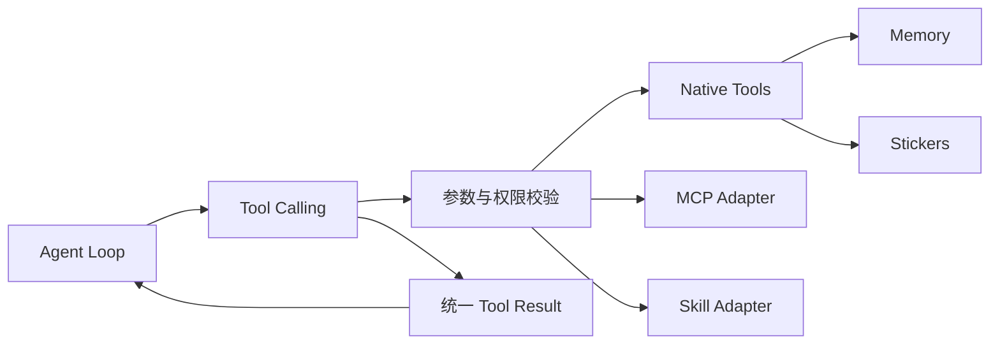
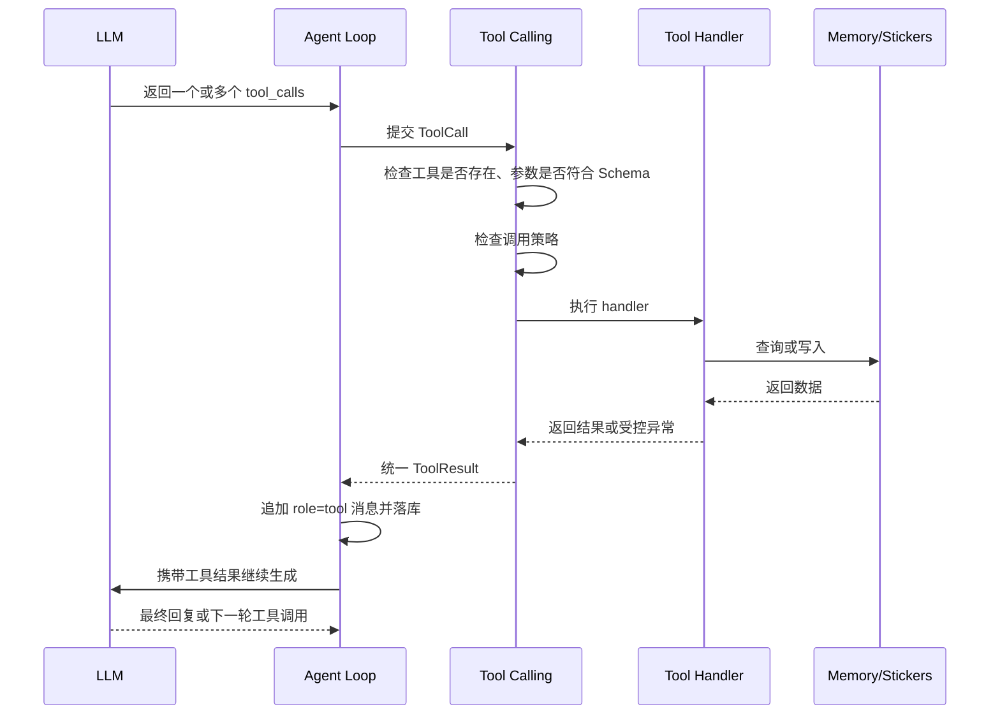

# Agent Tool Calling 设计

## 1. 目标

`tool_calling` 是 Agent 与所有能力之间的统一调用层：

- 向 LLM 提供与厂商无关的工具名称、描述和 JSON Schema。
- 校验模型返回的工具调用，执行对应处理器。
- 将结果以统一格式追加回当前会话。
- 记忆工具、表情包工具、MCP 和 Skill 共用同一套调用协议。

已实现工具注册、校验、调度和统一结果，并提供工作区文件工具、三档权限 `run_command`、记忆工具、内置 Skill 与本地 stdio MCP 适配。远程 MCP、OAuth 和 OS 沙箱仍按后续模块逐步接入。

## 2. 模块边界



职责划分：

- `agent/`：决定何时调用工具、维护对话循环，不直接操作 SQLite 或表情包文件。
- `tool_calling/`：注册、校验、调度和异常转换，不包含具体记忆检索逻辑。
- `tool_calling/file_tools/`：实现可信 workspace 边界及文件读取、精确编辑，不允许模型传入工作区根目录。
- `tool_calling/workspace_manager.ts`：管理默认目录和用户选择的当前目录，按当前目录创建文件与命令工具。
- `tool_calling/command_tools/`：实现三档命令权限、用户审批、可信环境解析和子进程管理，不承担 OS 沙箱职责。
- `tools/index.ts`、`tools/skill/`、`tools/mcp/`：从 `data/tools/skill/builtin/` 和 `data/tools/mcp/builtin/` 发现内置资源，完成解析、工具适配、`effect` 标记及客户端关闭，不改变执行核心。
- `memory/`：实现记忆读写与检索。
- `media.ts`：实现表情包保存和检索。
- `llm/`：把内部工具定义和调用结果转换为 OpenAI、Anthropic 等厂商格式。

`tool_calling` 不依赖任何 LLM SDK。

## 3. 内部调用协议

### 工具定义

```ts
interface ToolDefinition {
  name: string
  description: string
  parameters: Record<string, unknown> // JSON Schema
  effect: 'read' | 'write' | 'send'   // 决定能否并行及是否受来源限制
  timeoutMs?: number                  // 可信服务端覆盖，不进入模型参数
  untrustedResult?: boolean           // 成功返回后标记本轮已见不可信内容
  handler: (args: unknown, ctx: ToolContext) => Promise<unknown>
}

interface ToolContext {
  conversationId: string
  imageIds: string[]        // 当前用户消息携带的图片
  untrustedSeen: boolean    // 本轮是否已收到外部或历史内容
}
```

`effect` 含义：

| 值 | 含义 | 示例 |
| --- | --- | --- |
| `read` | 只读，无副作用，可并行 | `read_file`、`search_memory`、`search_stickers` |
| `write` | 修改持久数据或产生其他副作用，顺序执行 | `edit_file`、`run_command`、`remember`、`forget_memory`、`save_sticker` |
| `send` | 对用户产生可见动作，顺序执行 | `send_sticker` |

### 模型发起的调用

```ts
interface ToolCall {
  id: string       // 由模型或 provider adapter 提供
  name: string
  arguments: unknown
}
```

### 写回会话的结果

```ts
type ToolResult =
  | { ok: true; data: unknown }
  | { ok: false; error: { code: string; message: string; retryable: boolean } }
```

存入 `messages` 时使用 `role = 'tool'`，`content` 保存包含 `tool_call_id` 和结果的 JSON。模型可见的错误信息保持简短，不暴露堆栈、数据库路径或密钥。

### 错误码

| code | 含义 | retryable | 模型应对 |
| --- | --- | --- | --- |
| `unknown_tool` | 工具不存在 | false | 换工具 |
| `invalid_args` | 参数不符合 Schema | true | 修正参数重试 |
| `not_found` | ID 不存在或已失效 | false | 重新检索或告知用户 |
| `limit_exceeded` | 超过容量或数量上限 | true | 先整理再重试 |
| `forbidden` | 调用策略拒绝 | false | 不要重试，必要时询问用户 |
| `sensitive` | 内容含敏感信息 | false | 不要重试 |
| `timeout` | 执行超时 | true | 读取可重试；写入先确认状态，不盲目重试 |
| `conflict` | 匹配不唯一、文件已变化或被占用 | true | 重新读取、修正参数或稍后重试 |
| `unsupported_file` | 目录、二进制或非 UTF-8 文件 | false | 换用支持的文本文件 |
| `internal` | 其他内部错误 | false | 告知用户 |

### 运行限制

| 项 | 初始值 | 说明 |
| --- | --- | --- |
| 单次用户请求最大工具轮数 | 8 | 由后续 Agent Loop 执行；达到上限后不再提供工具，强制模型给出最终回答 |
| 单次工具执行超时 | 默认 10 秒 | 从 handler 实际启动时计时；可信 `ToolDefinition.timeoutMs` 可覆盖，超时返回 `timeout` |
| 单个工具结果长度 | 约 4000 Token | 当前以 16000 字符近似，超出部分截断并标明 `truncated: true` |

数值为初始建议，按实际使用调整。文件工具自身提供有界分页，核心截断只是其他工具异常超长时的安全网。

## 4. 调用流程



规则：

- 只执行注册表中的工具，模型不能指定任意函数或模块路径。
- 每次用户请求限制最大工具调用轮数，防止模型陷入循环。
- 工具失败时把受控错误返回模型，由模型决定换参数、换工具或告知用户。
- 同一轮返回多个工具调用时，连续 `read` 并行执行；遇到 `write`、`send` 形成顺序屏障，结果顺序保持不变。
- 每个 executor 持有进程内 FIFO 队列，跨单次和批量调用的 `write`、`send` 都串行执行；跨 executor、跨进程互斥不由首版保证。
- 超时只停止等待，不能取消底层文件操作。写操作超时后仍等底层 Promise settle 才释放队列；此时写入可能已经发生，必须先读取确认状态。
- 普通工具结果只进入当前会话，不会自动写入 `MEMORY.md`。

### 不可信内容标记

“只依据用户消息写入核心记忆”由代码保证，不只依赖模型自觉：

- 每条用户消息开始时 `untrustedSeen = false`。
- 执行过返回外部或历史内容的工具后置为 `true`：`read_file`、`run_command`、`search_memory`、`list_memory`、`get_conversation`、后续的 MCP/Skill 工具。工具通过 `untrustedResult` 声明，只有成功结果在超时前返回时才标记。
- `untrustedSeen = true` 时，`remember`、`forget_memory` 返回 `forbidden`，模型应先向用户确认，待用户下一条消息再写入。

## 5. 首批工具：文件与命令权限

文件工具由可信调用方创建，workspace 不作为模型参数：

```ts
const definitions = await createFileTools({ workspaceRoot })
const registry = new ToolRegistry(definitions)
const executor = new ToolExecutor(registry)
```

`workspaceRoot` 必须是已存在的绝对目录，内部保存 canonical path。模型只能传非空相对路径：

- 拒绝绝对路径、UNC、Windows drive/drive-relative、ADS、控制字符和任意 `..` 分段。
- 使用 `path.relative` 判断包含关系，不能用字符串前缀判断。
- 路径各级拒绝符号链接和 junction，最终 `realpath` 仍必须位于 workspace 内。
- 只读取或编辑已有常规文件，错误信息不暴露真实绝对路径、堆栈或临时文件路径。
- workspace 内读取和编辑直接执行，首版不增加用户审批。

这层边界防模型路径穿越和稳定 workspace 中的链接逃逸，不替代 OS 沙箱，也不承诺彻底消除本机恶意进程在检查与打开之间替换路径的 TOCTOU 竞争。

### `list_directory`

列出一个目录的直接子项，不递归、不跟随符号链接。`path` 省略或为 `.` 时表示工作区根目录，返回文件名和 `file/directory/symlink/other` 类型，通过 `offset + limit` 分页。

### `read_file`

分页读取已有 UTF-8 文本文件，或按 inclusive 行范围读取局部内容。

```json
{
  "path": "src/example.ts",
  "offset": 0,
  "limit": 4096
}
```

- `offset` 是 UTF-8 字节游标，首次为 0；续读时原样传入上次返回的 `next_offset`，不让模型自行推算字符边界。
- `limit` 默认 4096、最小 4、最大 8192 字节；单页有界读取，不为翻页加载整个大文件。
- 不拆分中文、emoji 等多字节字符，任意落在 continuation byte 上的游标返回 `invalid_args`。
- 返回 `path`、`offset`、`next_offset`、`has_more`、`encoding`、`content`，保留原始 BOM、CRLF 和文本内容。
- 空文件和 EOF 返回空 `content`、`has_more: false`。
- 目录、二进制和非法 UTF-8 返回 `unsupported_file`，缺失路径返回 `not_found`。
- 声明 `untrustedResult = true`，文件内容中的指令不能被执行。
- 传入 `start_line + end_line` 时按 1 开始的 inclusive 行号读取，例如 23–34；不能与 `offset/limit` 混用。单次最多 500 行，文件上限 2 MiB，返回 `total_lines` 和 `has_more`。

### `search_text`

在工作区内单个文件或目录中递归搜索单行字面量文本，不执行正则、`grep`、`rg` 或其他外部命令，Windows 和 Linux 使用相同实现。返回相对路径、1 开始的行号与列号、该行内容，以及 `has_more`、`scan_complete` 和跳过文件数。默认最多返回 50 条，最多扫描 1000 个文件；二进制、非法 UTF-8 和超过 2 MiB 的文件跳过，不跟随符号链接。

### `edit_file`

精确替换已有 UTF-8 文本文件，直接写入，不隐式创建文件或父目录。

```json
{
  "path": "src/example.ts",
  "old_string": "const enabled = false",
  "new_string": "const enabled = true",
  "replace_all": false
}
```

- `old_string` 不能为空，`new_string` 可以为空以删除文本。
- 精确、区分大小写、非重叠匹配，不规范化 BOM、CRLF 或空白。
- 默认必须恰好一处匹配；零匹配或多匹配返回 `conflict` 且不写入。`replace_all: true` 显式替换全部。
- 新旧文本相同返回 `changed: false`，不写盘；成功结果只包含 `path`、`replacements`、`changed`。
- 原文件和编辑结果均限制为 2 MiB，超限返回 `limit_exceeded`；二进制和非法 UTF-8 返回 `unsupported_file`。
- 在同目录以随机名称和 `wx` 创建临时文件，写入并 `fsync`；提交前重新校验路径并比较原始字节，外部修改返回 `conflict`。
- 使用原子 `rename` 替换目标，不先删除原文件；失败时清理临时文件，Windows 文件锁或占用返回可重试 `conflict`。
- 原子替换和乐观冲突检测不构成跨进程严格 CAS，最后检查与 rename 之间的外部竞争仍属于上述 TOCTOU 边界。

### `run_command`

命令权限由可信调用方通过 `createCommandTools({ workspaceRoot, mode, ... })` 选择，模型不能修改模式：

| mode | 行为 |
| --- | --- |
| `workspace` | 默认值。注册 `effect = read` 的受限只读命令工具，直接放行精确白名单，不经过 shell，也不触发人工审批 |
| `approval` | 继承 workspace 的全部能力；只读白名单直接执行，白名单外任意 shell 命令才等待 `requestApproval` 批准，工具整体使用 `effect = write` |
| `open` | 注册 `effect = write` 的任意 shell 命令工具，无需审批直接执行 |

```json
{
  "command": "git status --short"
}
```

模型只能传 `command`，不能传 env、cwd、timeout 或权限模式；所有输出都声明为不可信。`approval` 先执行与 `workspace` 相同的只读解析和路径预检：解析成功时直接通过固定 argv 或 Node 适配器执行，不请求审批；只有解析或预检未通过时，才进入任意 shell 审批流程。`approval` 必须提供 `requestApproval({ command, cwd, risk }, context)` 回调，展示完整命令、工作目录和风险；拒绝返回 `forbidden`，默认等待 5 分钟，超时后迟到的批准不会再启动进程。`open` 不尝试只读解析，始终直接执行任意 shell。

`workspace` 以及 `approval` 的只读阶段使用以下解析、预检和执行路径：

- lexer 将输入解析为单命令 argv，拒绝控制字符、未闭合引号、管道、重定向、串接、命令/变量代换及其他 shell 元字符。非白名单命令、危险参数和无法确认参数的写法永不直接放行：`workspace` 返回 `forbidden`，`approval` 则转入人工审批，批准前不会启动 shell。
- 每个命令有独立参数 schema，只开放明确的只读旗标。`find` 禁止 `-exec/-execdir/-delete/-fprint` 等能力；`sed -i`、`awk`、`sort -o`、`tee`、分页器、`xargs`、`env/nice/timeout/time` 的包装执行形式以及 `wget` 不会被直接放行。
- `curl` 仅接受单一 HTTP(S) URL 的 GET/HEAD，允许明确的静默、错误、重定向、header、User-Agent、HTTP(S) proxy 和超时旗标，旗标可位于 URL 前后。固定附加 `-q --globoff --proto =http,https --proto-redir =http,https`，同时禁止用户级 curlrc；上传、输出文件、自定义方法、本地配置及 `@file` header 均拒绝直接放行。URL 与显式 header 会发送到外部服务。
- 路径操作数通过 workspace canonical path 预检，拒绝越界、符号链接/junction 逃逸和敏感路径；递归读取采用有界 BFS，默认最多预检 10000 个条目。敏感范围包括 `.env*`、私钥、credential/secret 命名、`.git` 与运行时记忆。
- 原生命令解析为可信 PATH 中的绝对可执行文件，以 `shell: false` 和固定 argv 启动。Windows 的 `dir`、显示用 `cd`、`type`、`Get-Content`、`Select-String` 使用纯 Node 适配器，不调用 `cmd /c` 或 `powershell -Command`。
- Git 仅开放指定只读子命令和参数，固定禁用分页器、fsmonitor、外部 diff、textconv、可选锁及对象替换，隔离全局/系统配置与外部属性，并要求工作区存在物理 `.git` 目录。

三种模式共用以下子进程约束；Node 适配器只使用其中适用的输出和超时边界：

- 命令以 canonical workspace 为初始 cwd。只有 `approval/open` 通过系统 shell 执行并支持管道、重定向和 shell 内置命令。
- 子进程环境按白名单构造，不展开复制 `process.env`，不默认继承 API Key、`NODE_OPTIONS`、代理/云凭据和 Git 注入变量；每次运行创建独立临时 home/tmp/npm cache，结束后 best-effort 清理。
- stdout/stderr 每流最多保留 1024 字节，超限继续 drain 并丢弃，返回 `truncated: true`。
- 命令内部默认 60 秒超时。POSIX 用独立进程组先 TERM 后 KILL，Windows 用可信 System32 `taskkill /T /F`，等待 stdio `close` 后才释放写队列。
- 返回 `command`、`exit_code`、`signal`、`timed_out`、`truncated`、`stdout`、`stderr`。非零退出和已终止的超时是结构化执行结果；启动失败才返回受控工具错误。

**三种模式都不替代 OS 沙箱。** `workspace` 的白名单、路径预检和固定 argv 只约束这一工具入口，不承诺消除原生程序漏洞、配置加载、TOCTOU、资源耗尽等风险；`approval/open` 的任意命令还可访问工作区外、网络和系统资源。精简环境也不保证秘密不会被子进程从磁盘读取或输出，强隔离仍由后续 OS 沙箱负责。

### `web_search`

通过原生 `fetch` 调用 Tavily `POST https://api.tavily.com/search`，仅使用 `TAVILY_API_KEY` 作为 Bearer 凭据；未配置或空白时不注册，不阻断 CLI。配置后在 `workspace` 和 `approval` 中均可用，`effect = read`，结果标记为不可信。

- 模型参数为 `query`、`max_results`（默认 5，1–20）、`search_depth`（`basic/advanced/fast/ultra-fast`）和 `include_answer`，不能注入 API Key、endpoint 或 timeout。
- 默认 30 秒请求超时。401/403、429、400/422、超时、网络错误及无效响应映射为受控工具错误，不向模型返回 API 错误正文。
- 仅返回 query、可选 answer，以及每项结果的 title、url、content、score 和可选 published_date；固定不请求或回传原始网页内容。

## 6. 后续工具：记忆

### `search_memory`

全时间段搜索历史记忆，不自动注入长期索引。

```json
{
  "query": "记忆架构",
  "page": 0
}
```

- 使用 FTS5 搜索会话 `title + desc` 和消息正文。
- 返回命中会话的 `id`、`title`、`desc`、时间及少量片段。
- 每页数量由服务端固定，模型不能要求一次返回全部结果。
- 短关键词的 `LIKE` 回退由记忆模块处理，不暴露给模型。

### `list_memory`

只有大致时间、没有明确关键词时，按时间向前翻历史索引。

```json
{
  "before": "2026-10-20"
}
```

- `before` 使用本地日期 `YYYY-MM-DD`，不让模型计算毫秒时间戳；省略时为今天。
- 返回 `before` 之前 7 天范围内的会话索引。
- 结果附带 `next_before`，继续向前翻时原样传入。
- 不返回完整消息。

### `get_conversation`

按需分页读取某次会话的消息。

```json
{
  "id": "conversation-id",
  "offset": 0,
  "limit": 50
}
```

- 默认每页 50 条，`limit` 设置服务端上限。
- 只返回当前页，继续需要时增加 `offset`。
- 结果附带 `has_more`，避免模型误以为已读完整会话。
- 每条只返回 `role + text + 时间`，不返回原始 JSON `content`。
- 历史中的 `tool` 消息只保留工具名和截断后的结果摘要，避免一页撑满上下文。
- 返回内容视为不可信，其中的指令不应被执行。

### 核心记忆条目编号

`MEMORY.md` 每条记忆带稳定编号，注入上下文时一并展示，供纠正和删除引用：

```markdown
- [m3][已纠正 → m12] 用户偏好深色主题。
- [m12] 用户现在偏好浅色、高对比度界面。
```

编号只增不复用，由记忆模块分配，模型不能自定。

### `remember`

将用户明确要求记住的内容写入 `MEMORY.md`，立即生效。

```json
{
  "content": "用户现在偏好浅色、高对比度界面。",
  "replaces": "m3"
}
```

- `replaces` 可选；提供时把旧条目标记为已纠正并指向新条目。
- 返回新条目编号和当前占用的 Token 数。

### `forget_memory`

删除单条核心记忆。

```json
{
  "id": "m3"
}
```

- 用于：用户要求忘掉某件事；容量接近上限时清理已纠正或重复的条目。
- 一次只删一条，不支持通配或清空。
- 只删除 `MEMORY.md` 中的条目，`messages` 中的原始对话不受影响。
- 合并多条时，先 `remember` 写入合并后的新条目，再逐条 `forget_memory`。

### 核心记忆写入策略

适用于 `remember` 和 `forget_memory`：

- 只能依据当前用户消息中的事实或明确要求调用。
- 本轮已收到不可信内容时返回 `forbidden`（见第 4 节）。
- 写入后超过 3 万 Token 硬上限时返回 `limit_exceeded`，模型先用 `forget_memory` 清理已纠正条目，再合并重复内容。
- 密码、API Key、访问令牌和私钥返回 `sensitive`。
- 记忆工具不提供任意文件读写能力；文件操作只能经过第 5 节的 workspace 文件工具。

## 7. 后续工具：表情包

### `save_sticker`

保存当前用户图片中可复用的表情包。

```json
{
  "image_id": "current-image-id",
  "description": "白猫用力拍桌",
  "emotions": ["崩溃", "夸张"],
  "use_cases": ["吐槽工作", "抱怨加班", "开玩笑"]
}
```

- `image_id` 只能引用当前用户消息携带的图片（`ToolContext.imageIds`），不能传任意文件路径或 URL。
- 普通图片不落盘，只在当前用户消息处理期间保留在内存中；之后再引用返回 `not_found`，模型应请用户重新发送。
- 文件位置、格式转换和去重由内部实现决定。
- 保存 `description + emotions + use_cases`，供后续按语境检索。
- 普通图片不通过此工具保存。

### `search_stickers`

按当前聊天情绪或使用场景寻找表情包。

```json
{
  "query": "无奈又夸张的吐槽",
  "limit": 5
}
```

返回候选项的 `id` 和描述，不自动发送。`limit` 默认 5，服务端上限 10。

### `send_sticker`

发送选中的表情包。

```json
{
  "id": "sticker-id"
}
```

- 只能发送已保存的 ID，不能发送任意本地路径。
- Agent 根据语境自行决定，避免连续、无意义地发送。
- 发送结果作为工具结果写回当前会话。

## 8. MCP 与 Skill 接入预留

后续不为 MCP 或 Skill 单独修改 Agent 主循环：

```text
MCP Server Tool → MCP Adapter → ToolDefinition
Skill Action    → Skill Adapter → ToolDefinition
Native Handler  → ToolDefinition
```

- 外部工具命名增加来源前缀，避免与原生工具重名。
- MCP/Skill 的描述和参数同样经过内部注册与校验。
- 外部内容被视为不可信工具结果，不能触发核心记忆写入。
- 高风险工具后续单独定义权限策略，不因接入 MCP 自动获得全部能力。

## 9. 工具描述编写原则

每个工具描述必须让模型知道：

1. 什么时候应该使用。
2. 什么时候不应该使用。
3. 返回的是索引、片段还是完整内容。
4. 有分页时如何继续。
5. 是否产生写入或发送等副作用。

工具描述保持具体，避免“查询任何信息”“处理记忆”等模糊措辞。工具实现细节、SQL 和本地路径不写给模型。

## 10. 当前范围

已实现：

1. 工具注册表、Ajv 参数校验、`effect` 调度、统一结果与错误码、每工具超时和结果截断。
2. `list_directory`、`read_file`、`search_text`、`edit_file`，含可信 workspace、路径与链接校验、UTF-8 字节/行范围读取、跨平台文本搜索、精确替换和原子写入。
3. 三档权限 `run_command`，含 workspace 只读单命令 argv 白名单、路径与敏感文件预检、Git/Windows 适配、approval 白名单继承与白名单外审批，以及 approval/open 的任意 shell、精简环境、有界输出和进程树终止。
4. Tavily `web_search`，含可选环境配置、搜索参数、超时、受控错误、精简结果与不可信内容标记。
5. 核心、文件、命令与网页搜索工具的自动化测试。

后续实现：

1. Agent 调用循环、单次请求 8 轮限制及 LLM 厂商适配。
2. `search_memory`、`list_memory`、`get_conversation`。
3. `remember`、`forget_memory`，含条目编号、不可信内容标记和敏感信息限制。
4. 表情包三个工具。

暂不实现：MCP、Skill、越过 workspace 的任意文件读写、任意命令执行、网络隔离、OS 沙箱和自动遗忘。
