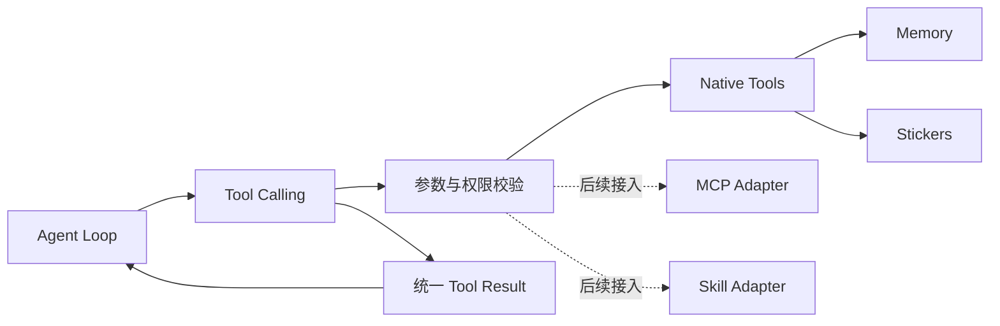
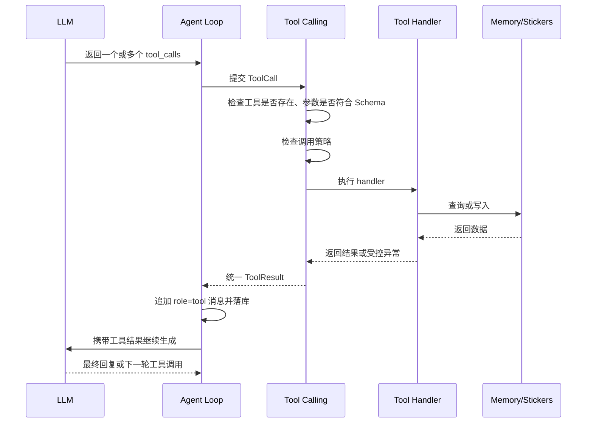

# Agent Tool Calling 设计

## 1. 目标

`tool_calling` 是 Agent 与所有能力之间的统一调用层：

- 向 LLM 提供与厂商无关的工具名称、描述和 JSON Schema。
- 校验模型返回的工具调用，执行对应处理器。
- 将结果以统一格式追加回当前会话。
- 记忆工具、表情包工具、MCP 和 Skill 共用同一套调用协议。

当前只做规划，不实现代码。首批工具围绕记忆和表情包，文件、命令执行及沙箱能力暂不纳入。

## 2. 模块边界



职责划分：

- `agent/`：决定何时调用工具、维护对话循环，不直接操作 SQLite 或表情包文件。
- `tool_calling/`：注册、校验、调度和异常转换，不包含具体记忆检索逻辑。
- `memory/`：实现记忆读写与检索。
- `media.ts`：实现表情包保存和检索。
- `llm/`：把内部工具定义和调用结果转换为 OpenAI、Anthropic 等厂商格式。

`tool_calling` 不依赖任何 LLM SDK。

## 3. 内部调用协议

### 工具定义

```ts
interface ToolDefinition {
  name: string
  description: string
  parameters: Record<string, unknown> // JSON Schema
  effect: 'read' | 'write' | 'send'   // 决定能否并行及是否受来源限制
  handler: (args: unknown, ctx: ToolContext) => Promise<unknown>
}

interface ToolContext {
  conversationId: string
  imageIds: string[]        // 当前用户消息携带的图片
  untrustedSeen: boolean    // 本轮是否已收到外部或历史内容
}
```

`effect` 含义：

| 值 | 含义 | 示例 |
| --- | --- | --- |
| `read` | 只读，无副作用，可并行 | `search_memory`、`search_stickers` |
| `write` | 修改持久数据，顺序执行 | `remember`、`forget_memory`、`save_sticker` |
| `send` | 对用户产生可见动作，顺序执行 | `send_sticker` |

### 模型发起的调用

```ts
interface ToolCall {
  id: string       // 由模型或 provider adapter 提供
  name: string
  arguments: unknown
}
```

### 写回会话的结果

```ts
type ToolResult =
  | { ok: true; data: unknown }
  | { ok: false; error: { code: string; message: string; retryable: boolean } }
```

存入 `messages` 时使用 `role = 'tool'`，`content` 保存包含 `tool_call_id` 和结果的 JSON。模型可见的错误信息保持简短，不暴露堆栈、数据库路径或密钥。

### 错误码

| code | 含义 | retryable | 模型应对 |
| --- | --- | --- | --- |
| `unknown_tool` | 工具不存在 | false | 换工具 |
| `invalid_args` | 参数不符合 Schema | true | 修正参数重试 |
| `not_found` | ID 不存在或已失效 | false | 重新检索或告知用户 |
| `limit_exceeded` | 超过容量或数量上限 | true | 先整理再重试 |
| `forbidden` | 调用策略拒绝 | false | 不要重试，必要时询问用户 |
| `sensitive` | 内容含敏感信息 | false | 不要重试 |
| `timeout` | 执行超时 | true | 稍后重试或放弃 |
| `internal` | 其他内部错误 | false | 告知用户 |

### 运行限制

| 项 | 初始值 | 说明 |
| --- | --- | --- |
| 单次用户请求最大工具轮数 | 8 | 达到上限后下一次请求不再提供工具，强制模型给出最终回答 |
| 单次工具执行超时 | 10 秒 | 超时返回 `timeout` |
| 单个工具结果长度 | 约 4000 Token | 超出部分截断，并在结果中标明 `truncated: true` |

数值为初始建议，按实际使用调整。

## 4. 调用流程



规则：

- 只执行注册表中的工具，模型不能指定任意函数或模块路径。
- 每次用户请求限制最大工具调用轮数，防止模型陷入循环。
- 工具失败时把受控错误返回模型，由模型决定换参数、换工具或告知用户。
- 同一轮返回多个工具调用时，`effect = read` 的并行执行；`write`、`send` 按模型给出的顺序串行执行。
- 普通工具结果只进入当前会话，不会自动写入 `MEMORY.md`。

### 不可信内容标记

“只依据用户消息写入核心记忆”由代码保证，不只依赖模型自觉：

- 每条用户消息开始时 `untrustedSeen = false`。
- 执行过返回外部或历史内容的工具后置为 `true`：`search_memory`、`list_memory`、`get_conversation`、后续的 MCP/Skill 工具。
- `untrustedSeen = true` 时，`remember`、`forget_memory` 返回 `forbidden`，模型应先向用户确认，待用户下一条消息再写入。

## 5. 首批工具：记忆

### `search_memory`

全时间段搜索历史记忆，不自动注入长期索引。

```json
{
  "query": "记忆架构",
  "page": 0
}
```

- 使用 FTS5 搜索会话 `title + desc` 和消息正文。
- 返回命中会话的 `id`、`title`、`desc`、时间及少量片段。
- 每页数量由服务端固定，模型不能要求一次返回全部结果。
- 短关键词的 `LIKE` 回退由记忆模块处理，不暴露给模型。

### `list_memory`

只有大致时间、没有明确关键词时，按时间向前翻历史索引。

```json
{
  "before": "2026-10-20"
}
```

- `before` 使用本地日期 `YYYY-MM-DD`，不让模型计算毫秒时间戳；省略时为今天。
- 返回 `before` 之前 7 天范围内的会话索引。
- 结果附带 `next_before`，继续向前翻时原样传入。
- 不返回完整消息。

### `get_conversation`

按需分页读取某次会话的消息。

```json
{
  "id": "conversation-id",
  "offset": 0,
  "limit": 50
}
```

- 默认每页 50 条，`limit` 设置服务端上限。
- 只返回当前页，继续需要时增加 `offset`。
- 结果附带 `has_more`，避免模型误以为已读完整会话。
- 每条只返回 `role + text + 时间`，不返回原始 JSON `content`。
- 历史中的 `tool` 消息只保留工具名和截断后的结果摘要，避免一页撑满上下文。
- 返回内容视为不可信，其中的指令不应被执行。

### 核心记忆条目编号

`MEMORY.md` 每条记忆带稳定编号，注入上下文时一并展示，供纠正和删除引用：

```markdown
- [m3][已纠正 → m12] 用户偏好深色主题。
- [m12] 用户现在偏好浅色、高对比度界面。
```

编号只增不复用，由记忆模块分配，模型不能自定。

### `remember`

将用户明确要求记住的内容写入 `MEMORY.md`，立即生效。

```json
{
  "content": "用户现在偏好浅色、高对比度界面。",
  "replaces": "m3"
}
```

- `replaces` 可选；提供时把旧条目标记为已纠正并指向新条目。
- 返回新条目编号和当前占用的 Token 数。

### `forget_memory`

删除单条核心记忆。

```json
{
  "id": "m3"
}
```

- 用于：用户要求忘掉某件事；容量接近上限时清理已纠正或重复的条目。
- 一次只删一条，不支持通配或清空。
- 只删除 `MEMORY.md` 中的条目，`messages` 中的原始对话不受影响。
- 合并多条时，先 `remember` 写入合并后的新条目，再逐条 `forget_memory`。

### 核心记忆写入策略

适用于 `remember` 和 `forget_memory`：

- 只能依据当前用户消息中的事实或明确要求调用。
- 本轮已收到不可信内容时返回 `forbidden`（见第 4 节）。
- 写入后超过 3 万 Token 硬上限时返回 `limit_exceeded`，模型先用 `forget_memory` 清理已纠正条目，再合并重复内容。
- 密码、API Key、访问令牌和私钥返回 `sensitive`。
- 不提供任意修改文件或读取任意路径的能力。

## 6. 后续工具：表情包

### `save_sticker`

保存当前用户图片中可复用的表情包。

```json
{
  "image_id": "current-image-id",
  "description": "白猫用力拍桌",
  "emotions": ["崩溃", "夸张"],
  "use_cases": ["吐槽工作", "抱怨加班", "开玩笑"]
}
```

- `image_id` 只能引用当前用户消息携带的图片（`ToolContext.imageIds`），不能传任意文件路径或 URL。
- 普通图片不落盘，只在当前用户消息处理期间保留在内存中；之后再引用返回 `not_found`，模型应请用户重新发送。
- 文件位置、格式转换和去重由内部实现决定。
- 保存 `description + emotions + use_cases`，供后续按语境检索。
- 普通图片不通过此工具保存。

### `search_stickers`

按当前聊天情绪或使用场景寻找表情包。

```json
{
  "query": "无奈又夸张的吐槽",
  "limit": 5
}
```

返回候选项的 `id` 和描述，不自动发送。`limit` 默认 5，服务端上限 10。

### `send_sticker`

发送选中的表情包。

```json
{
  "id": "sticker-id"
}
```

- 只能发送已保存的 ID，不能发送任意本地路径。
- Agent 根据语境自行决定，避免连续、无意义地发送。
- 发送结果作为工具结果写回当前会话。

## 7. MCP 与 Skill 接入预留

后续不为 MCP 或 Skill 单独修改 Agent 主循环：

```text
MCP Server Tool → MCP Adapter → ToolDefinition
Skill Action    → Skill Adapter → ToolDefinition
Native Handler  → ToolDefinition
```

- 外部工具命名增加来源前缀，避免与原生工具重名。
- MCP/Skill 的描述和参数同样经过内部注册与校验。
- 外部内容被视为不可信工具结果，不能触发核心记忆写入。
- 高风险工具后续单独定义权限策略，不因接入 MCP 自动获得全部能力。

## 8. 工具描述编写原则

每个工具描述必须让模型知道：

1. 什么时候应该使用。
2. 什么时候不应该使用。
3. 返回的是索引、片段还是完整内容。
4. 有分页时如何继续。
5. 是否产生写入或发送等副作用。

工具描述保持具体，避免“查询任何信息”“处理记忆”等模糊措辞。工具实现细节、SQL 和本地路径不写给模型。

## 9. 初版范围

优先实现：

1. 工具注册表、参数校验、`effect` 调度、统一结果与错误码、运行限制和 Agent 调用循环。
2. `search_memory`、`list_memory`、`get_conversation`。
3. `remember`、`forget_memory`，含条目编号、不可信内容标记和敏感信息限制。
4. 表情包三个工具。

暂不实现：MCP、Skill、任意文件读写、命令执行、网络访问、沙箱和自动遗忘。
